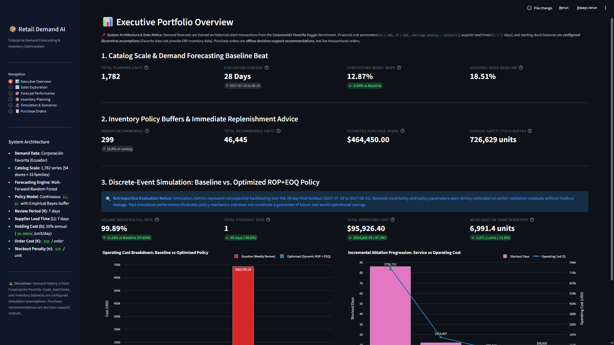
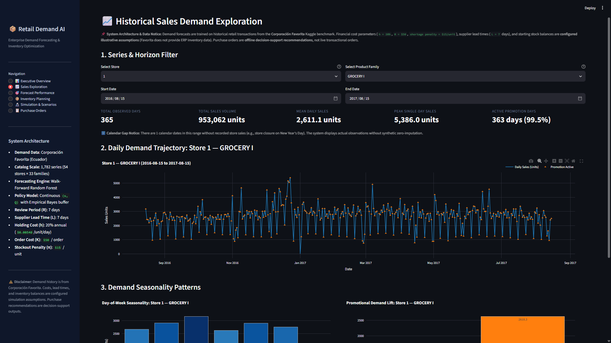
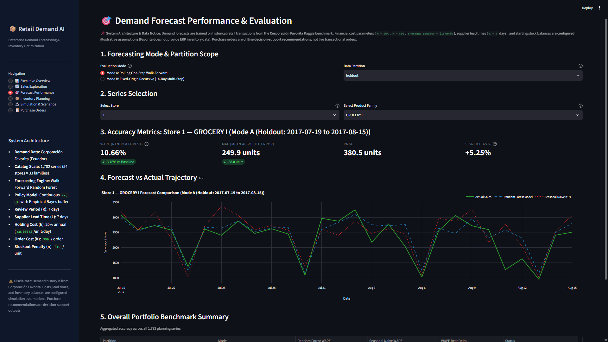
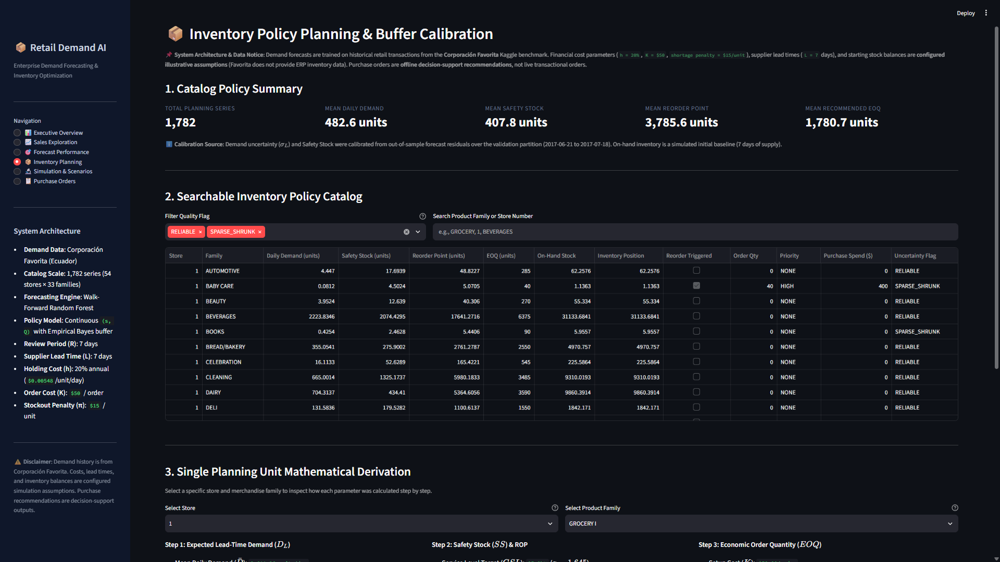
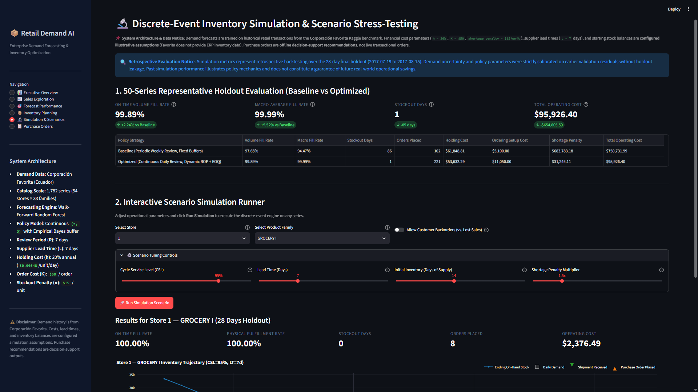
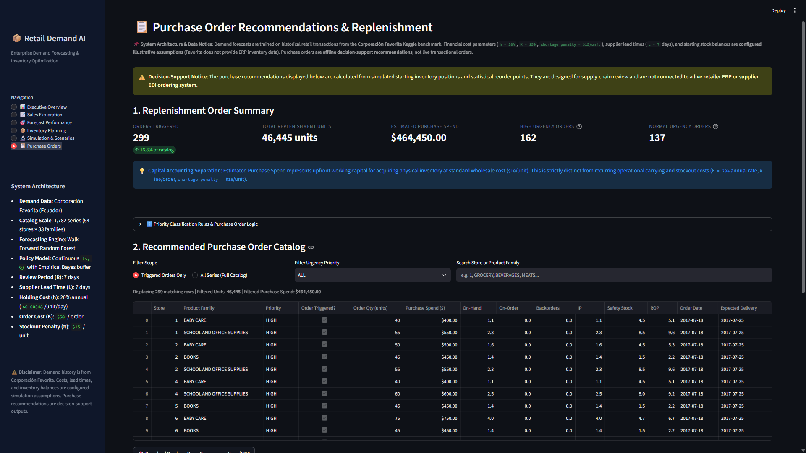

# Retail Sales Forecasting and Inventory Optimization System

[](https://www.python.org/downloads/)
[](docs/06_verification_and_validation.md)
[](https://github.com/AkashDas-AI/Retail-Sales-Forecasting-and-Inventory-Optimization-System/actions)
[](LICENSE)
[](app.py)
[](CONTRIBUTING.md)
[](docs/architecture.md)

An enterprise-grade predictive and prescriptive decision-support system. This project integrates machine learning retail demand forecasting with statistical inventory control and discrete-event simulation to calculate dynamic Safety Stock, Reorder Points, and Economic Order Quantities.

---

## 1. Project Overview

Retail supply chains face a perpetual trade-off between two operational risks:

1. Understocking and Lost Sales: Underestimating customer demand causes stockouts, missed revenue, customer dissatisfaction, and potential brand attrition.
2. Overstocking and Carrying Costs: Overestimating customer demand results in excessive working capital lockup, elevated warehouse storage costs, product obsolescence, and margin erosion through markdowns.

This system provides an end-to-end solution that connects historical store sales forecasting directly to inventory replenishment decisions. Rather than treating demand forecasting and inventory replenishment as isolated functions, the platform translates forecast uncertainty into statistical safety buffers, establishes reorder thresholds, generates batch replenishment orders, and evaluates policy performance via historical simulation.

Intended users include supply chain planners, inventory analysts, and merchandising operations teams seeking a structured, transparent, and reproducible framework for data-driven replenishment planning.

---

## 2. Project Objectives

The system fulfills four core technical and operational objectives:

1. Tabular Demand Forecasting: Train and evaluate supervised regression models across multi-store, multi-category retail time series, benchmarking against classical seasonal baselines across both rolling one-step and recursive multi-step forecasting horizons.
2. Statistical Policy Optimization: Translate out-of-sample forecast errors into empirical demand uncertainty distributions, calculating continuous review `(s, Q)` policies (Safety Stock, Reorder Point, and Economic Order Quantity) tailored to each store-category planning unit.
3. Discrete-Event Supply Chain Simulation: Backtest calculated inventory policies against historical demand over an out-of-sample holdout horizon, comparing service level attainment, stockout frequency, inventory levels, and operational costs against a fixed-interval replenishment baseline.
4. Interactive Decision Support Interface: Provide an interactive six-page Streamlit web application enabling operational planners to explore sales patterns, inspect forecast metrics, audit step-by-step policy derivations, stress-test supply chain scenarios, and export prioritized purchase orders.

---

## 3. Interactive Decision Support Interface and Visual Tour

Visual captures of the six coordinated Streamlit decision-support views demonstrating the system runtime:

### 3.1 Executive Overview
High-level enterprise summary presenting forecast accuracy benchmark cards, catalog-wide purchase requisitions, separated working capital spend, operating cost comparisons, and the 4-stage ablation study ladder.



### 3.2 Sales Exploration
Time-series visual analytics exploring historical demand patterns, promotional lift overlays, day-of-week seasonality profiles, and calendar continuity validation across all 1,782 series.



### 3.3 Forecast Performance
Out-of-sample forecast accuracy evaluation console comparing Random Forest against Seasonal Naive in Mode A (rolling 1-step walk-forward) and Mode B (recursive multi-step fixed-origin), with category-level error breakdowns and actual versus predicted trajectories.



### 3.4 Inventory Planning
Comprehensive planning catalog displaying calculated Safety Stock, Reorder Point (ROP), and Economic Order Quantity (EOQ) values across all 1,782 series, empirical Bayes reliability flags, and step-by-step mathematical policy derivations.



### 3.5 Simulation Analysis
Discrete-event simulation results across the 50-series holdout benchmark, dual fill rate metrics (volume-weighted versus macro-average), cost breakdown comparisons, and an interactive scenario tuning runner.



### 3.6 Purchase Orders
Operational replenishment procurement console with urgency priority tiers (CRITICAL, HIGH, NORMAL, NONE), working capital spend summaries, catalog search filters, and filtered CSV export.



---

## 4. Dataset and Data Limitations

### 4.1 Data Source and Granularity

The historical sales data is sourced from the public Corporacion Favorita Store Sales competition on Kaggle:
https://www.kaggle.com/competitions/store-sales-time-series-forecasting

The modeling dataset operates at the following granularity:
- Primary Key: `(date, store_nbr, family)`
- Temporal Horizon: Daily observations from 2013-01-01 to 2017-08-15 (approximately 3,000,000 transaction records)
- Catalog Scope: 54 retail stores across Ecuador and 33 distinct product families, yielding 1,782 continuous time series

Supplementary tables integrated into the feature pipeline include store metadata (`stores.csv`), daily transaction volumes (`transactions.csv`), public holiday events (`holidays_events.csv`), and daily crude oil spot prices (`oil.csv`).

### 4.2 Data Ingestion and Validation

The data ingestion pipeline (`src/retail_forecasting/data.py` and `src/retail_forecasting/validation.py`) enforces strict schema validation and quality controls:
- Explicit temporal continuity checks across all 1,782 series.
- Preservation of genuine non-trading days without synthetic zero-inflation across store closures or pre-opening dates.
- Null-handling and type validation for promotional indicators (`onpromotion`).
- Clean conversion and verification of date fields using portable parsing.

### 4.3 Data Limitations and Illustrative Assumptions

The Corporacion Favorita dataset contains point-of-sale customer purchase transactions. It does not provide enterprise resource planning (ERP) inventory positions, supplier order histories, lead times, or commercial cost accounting ledgers. Consequently, the following supply chain parameters are configured as baseline illustrative assumptions:
- Supplier Lead Time: 7 calendar days ($L = 7$).
- Unit Wholesale Cost: $10.00 per unit ($c = 10.00$).
- Annual Holding Cost Rate: 20% per annum ($h = 0.20$), equivalent to $0.005479 per unit per day ($h \cdot c / 365$).
- Fixed Order Placement Fee: $50.00 per purchase order ($K = 50.00$).
- Customer Stockout Shortage Penalty: $15.00 per unmet demand unit ($\pi = 15.00$).
- Initial Stock on Day Zero: 14 days of supply based on pre-period average daily sales.

Observed sales quantities represent transaction volumes. They do not represent unconstrained demand during periods when physical retail store shelves were exhausted.

---

## 5. Technology Stack

The project is built on the following technologies and libraries:

- Language: Python 3.11+
- Data Processing and Tabular Analytics: `pandas` (>= 2.2), `numpy` (>= 1.26)
- Machine Learning and Modeling: `scikit-learn` (>= 1.5), `joblib` (>= 1.3)
- Interactive Dashboard and Visualization: `streamlit` (>= 1.35), `plotly` (>= 5.20), `matplotlib` (>= 3.8), `seaborn` (>= 0.13)
- Test Harness and Quality Assurance: `pytest` (>= 8.0)
- Interactive Notebooks: `jupyterlab` (>= 4.0)

---

## 6. System Architecture

The pipeline processes data through six modular stages, ensuring clean separation of concerns and eliminating lookahead leakage:


1. Data Ingestion and Validation (`src/retail_forecasting/data.py`, `src/retail_forecasting/validation.py`): Ingests raw CSV files, validates schemas, verifies temporal bounds, and generates `reports/metrics/data_quality_report.json`.
2. Feature Engineering (`src/retail_forecasting/features.py`): Computes shifted calendar lags (1, 7, 14, 28 days), trailing rolling statistics (7, 14, 30 days), calendar cyclical encodings, and store-specific holiday transfer mappings.
3. Demand Forecasting (`src/retail_forecasting/forecasting.py`, `src/retail_forecasting/metrics.py`): Fits a multi-series Random Forest regressor on chronological train data and evaluates against a Seasonal Naive baseline across both walk-forward rolling and recursive horizons.
4. Inventory Policy Formulation (`src/retail_forecasting/inventory.py`, `src/retail_forecasting/recommendations.py`): Computes empirical Bayes lead-time demand uncertainty, calculates dynamic Safety Stock and Reorder Points, and derives Economic Order Quantities.
5. Discrete-Event Simulation (`src/retail_forecasting/simulation.py`): Executes daily replenishment cycles over the holdout period, reconciling inventory conservation, backorder and lost-sales mechanics, service level attainment, and total operating costs.
6. Web Interface (`app/streamlit_app.py`, `app/views/`): Serves interactive dashboards, visual analytics, policy derivations, scenario simulation controls, and replenishment order exports.

---

## 7. Forecasting Methodology

### 7.1 Evaluation Partitions and Chronological Design

To ensure zero future information leaks into training or validation, the dataset is split strictly by calendar date:
- Training Partition: 2016-01-01 to 2017-06-20 (537 calendar days)
- Validation Partition: 2017-06-21 to 2017-07-18 (28 calendar days, 49,896 observations across 1,782 series)
- Holdout Partition: 2017-07-19 to 2017-08-15 (28 calendar days, 49,896 observations across 1,782 series)

### 7.2 Forecasting Models

1. Seasonal Naive Baseline: Projects the exact same-series sales observation from exactly 7 calendar days prior ($y_{t-7}$). If the exact 7-day prior observation is missing, the model returns NaN rather than substituting an arbitrary imputation.
2. Random Forest Regressor: An ensemble of 60 decision trees (`max_depth=16`, `min_samples_leaf=4`, `max_features="sqrt"`, `random_state=42`) trained on 24 leakage-safe features comprising demand lags, rolling averages, rolling standard deviations, calendar cyclical transformations, and store-family indicators.

### 7.3 Evaluation Modes

- Mode A (Rolling One-Step Walk-Forward): Forecasts demand for date $t$ using feature states updated with actual observed history strictly prior to date $t$. Represents short-horizon daily inventory replenishment review.
- Mode B (Fixed-Origin Recursive Multi-Step): Forecasts demand over a 14-day horizon (2017-07-19 to 2017-08-01) from a single forecast origin (2017-07-18). Target predictions at step $t$ are recursively fed back into future lag features for steps $t+1$ through $t+14$. Represents long-horizon procurement planning without intermediate ground-truth feedback.

### 7.4 Forecast Accuracy Metrics and Verified Results

Forecast accuracy is evaluated using Weighted Absolute Percentage Error (WAPE), Mean Absolute Error (MAE), Root Mean Squared Error (RMSE), and Signed Bias Percentage:

$$\text{WAPE} = \frac{\sum |y_t - \hat{y}_t|}{\sum y_t} \times 100\%$$

$$\text{Bias} = \frac{\sum (\hat{y}_t - y_t)}{\sum y_t} \times 100\%$$

Verified evaluation results from `reports/metrics/forecast_evaluation_report.json`:

| Evaluation Partition | Evaluation Mode | Model | WAPE (%) | MAE (units) | RMSE (units) | Bias (%) |
| :--- | :--- | :--- | :--- | :--- | :--- | :--- |
| Validation | Mode A (Rolling 1-Step) | Seasonal Naive | 17.46% | 83.29 | 327.51 | +0.67% |
| Validation | Mode A (Rolling 1-Step) | Random Forest | 10.81% | 51.56 | 197.26 | +1.15% |
| Holdout | Mode A (Rolling 1-Step) | Seasonal Naive | 18.51% | 86.93 | 313.83 | +1.57% |
| Holdout | Mode A (Rolling 1-Step) | Random Forest | 12.87% | 60.45 | 209.03 | +1.23% |
| Holdout | Mode B (Recursive 14-Day) | Seasonal Naive | 15.21% | 73.10 | 277.27 | -3.90% |
| Holdout | Mode B (Recursive 14-Day) | Random Forest | 12.55% | 60.33 | 221.30 | -3.29% |

In the out-of-sample holdout partition, the Random Forest model achieves a 30.5% relative error reduction over the seasonal baseline in Mode A (12.87% versus 18.51% WAPE) and a 17.5% relative reduction in Mode B (12.55% versus 15.21% WAPE).

---

## 8. Inventory Optimization

### 8.1 Demand Uncertainty and Empirical Bayes Shrinkage

Inventory safety buffers depend on forecast residual variability over lead time rather than raw demand variability. For each planning unit $i$, the sample residual standard deviation $s_i$ is calibrated on validation set errors ($y_t - \hat{y}_t$).

To avoid under-buffering low-volume or intermittent series, empirical Bayes shrinkage blends the series sample variance $s_i^2$ toward the global pooled variance $\sigma_{\text{pool}}^2$:

$$\sigma_{\text{shrunk}, i} = \sqrt{\frac{n_i \cdot s_i^2 + k \cdot \sigma_{\text{pool}}^2}{n_i + k}}$$

Where $n_i$ is the number of active observations and $k = 7$ is the shrinkage prior weight. A safety floor of $\sigma_{\text{floor}} = 0.05$ units is enforced.

### 8.2 Lead-Time Demand and Safety Stock

Under lead time $L$ and autoregressive residual correlation $\rho$, lead-time demand variability is computed as:

$$\sigma_{L, i} = \sqrt{L \cdot \sigma_{\text{shrunk}, i}^2 \cdot \left(1 + \frac{2\rho}{1-\rho}\left(1 - \frac{1-\rho^L}{L(1-\rho)}\right)\right)}$$

For target Cycle Service Level $CSL = 0.95$ ($z = 1.645$):
- Lead-Time Demand: $\text{LTD}_i = \bar{d}_i \cdot L$
- Safety Stock: $\text{SS}_i = z \cdot \sigma_{L, i}$
- Reorder Point: $\text{ROP}_i = \text{LTD}_i + \text{SS}_i$

### 8.3 Economic Order Quantity and Order Triggers

Replenishment batch sizing uses the classical Economic Order Quantity (EOQ), balancing fixed order placement fees against inventory carrying costs:

$$\text{EOQ}_i = \sqrt{\frac{2 \cdot K \cdot \bar{D}_i}{h \cdot c}}$$

Where $\bar{D}_i = \bar{d}_i \cdot 365$ is annualized demand, $K = 50.00$ is fixed order cost, and $h \cdot c = 2.00$ is annual carrying cost per unit. The operational order quantity $Q^*_i$ is rounded to the nearest batch multiple of 5, subject to a minimum order quantity (MOQ) of 10 units.

### 8.4 Inventory Position and Reorder Trigger

Replenishment decisions are evaluated using the effective Inventory Position ($IP$):

$$IP_t = \text{On-Hand}_t + \text{On-Order}_t - \text{Backorders}_t$$

An order is placed if and only if $IP_t \le \text{ROP}$. When triggered, the recommended order quantity is:

$$Q_t = \max\left(Q^*, \text{ROP} - IP_t\right)$$

---

## 9. Simulation Methodology

### 9.1 Daily Discrete-Event Simulation Cycle

The discrete-event simulation engine (`src/retail_forecasting/simulation.py`) evaluates policies under strict daily accounting rules:

1. Receipt of In-Transit Deliveries: Orders scheduled for arrival on day $t$ enter on-hand stock and become immediately available for customer demand.
2. Demand Fulfillment: Customer demand for day $t$ is satisfied from available on-hand stock. Unmet demand is recorded as lost sales (or backlogged, depending on configuration).
3. Financial Accounting: Daily carrying costs are calculated as $h \cdot c / 365$ applied to ending physical stock. Unmet demand incurs shortage penalties of $\pi = 15.00$ per unit.
4. Inventory Review and Reordering: Inventory Position is evaluated against ROP. If triggered, a purchase order is dispatched with arrival scheduled for day $t + L$.

### 9.2 Holdout Benchmark Results

Policies were evaluated across a representative benchmark cohort of 50 store-category series over the 28-day holdout period (2017-07-19 to 2017-08-15).

Verified simulation results from `reports/metrics/simulation_evaluation_report.json`:

| Metric | Baseline Policy (Fixed Weekly Review) | Optimized Policy (Dynamic ROP and EOQ) | Operational Impact |
| :--- | :--- | :--- | :--- |
| Volume-Weighted Fill Rate | 97.65% | 99.89% | +2.24 percentage points |
| Macro-Average Fill Rate | 94.47% | 99.99% | +5.52 percentage points |
| Total Stockout Days | 86 days | 1 day | 98.8% reduction |
| Total Purchase Orders Placed | 102 orders | 221 orders | Smaller, responsive batches |
| Holding Cost | $61,848.81 | $53,632.29 | -13.3% |
| Order Placement Fees | $5,100.00 | $11,050.00 | Planned reorder frequency |
| Shortage Penalty Incurred | $683,783.18 | $31,244.11 | -95.4% |
| Total Operating Cost | $750,731.99 | $95,926.40 | -87.2% ($654,805.59 cost reduction) |

Note: Cost comparisons reflect the configured illustrative parameters ($h = 20\%$, $K = 50.00$, $\pi = 15.00$) and demonstrate the operational mechanics of dynamic buffering versus rigid periodic schedules. They do not represent realized commercial cash savings.

---

## 10. Streamlit Dashboard Architecture

The user interface is structured into six coordinated analytical views:

1. Executive Overview (`app/views/executive_overview.py`): Enterprise dashboard summarizing overall forecast accuracy gains, catalog-wide purchase requisitions, separated working capital spend, cost breakdown comparisons, and the 4-stage ablation ladder.
2. Sales Exploration (`app/views/sales_exploration.py`): Time-series visual analytics across historical sales volumes, promotional overlays, day-of-week seasonality, and calendar continuity validation.
3. Forecast Performance (`app/views/forecast_performance.py`): Detailed model evaluation console comparing Random Forest against Seasonal Naive in Mode A and Mode B, with category-level error breakdowns, residual distributions, and interactive Plotly trajectories.
4. Inventory Planning (`app/views/inventory_planning.py`): Comprehensive planning catalog displaying calculated Safety Stock, ROP, and EOQ values for all 1,782 series, empirical Bayes reliability flags, and step-by-step mathematical derivation breakdowns.
5. Simulation Analysis (`app/views/simulation_analysis.py`): Holdout simulation results, comparative inventory trajectory charts, and an interactive scenario runner allowing users to adjust service levels, lead times, initial inventory, and penalty costs.
6. Purchase Orders (`app/views/purchase_orders.py`): Actionable replenishment procurement console with urgency priority tiers (CRITICAL, HIGH, NORMAL, NONE), working capital spend summaries, search filters, and CSV export.

---

## 11. Project Structure

```
Retail Sales Forecasting & Inventory Optimization System/
├── .github/
│   └── workflows/
│       └── tests.yml                     # Continuous integration test workflow
├── .env.example                          # Safe environment variable configuration template
├── .gitignore                            # Excludes venvs, caches, binaries, and raw datasets
├── LICENSE                               # MIT License with dataset disclaimer
├── README.md                             # System documentation and architecture guide
├── pyproject.toml                        # Project metadata and pytest configuration
├── requirements.txt                      # Pinned Python package dependencies
├── app.py                                # Streamlit dashboard entry point
├── app/
│   ├── components/                       # Reusable UI widgets, charts, and banners
│   ├── data_loader.py                    # Cached data loading and artifact retrieval
│   ├── streamlit_app.py                  # Multi-page sidebar router and state manager
│   └── views/                            # Six coordinated dashboard page views
├── configs/
│   ├── project_config.json               # Core paths, horizons, and model settings
│   └── inventory_config.json             # Service level, lead time, and cost parameters
├── data/
│   ├── raw/                              # Raw Corporacion Favorita CSV files (untracked)
│   ├── processed/                        # Processed sales and feature matrices (untracked)
│   └── sample/                           # Lightweight demo and test fixtures
├── docs/                                 # Detailed architectural specifications and logs
│   ├── 01_system_architecture.md
│   ├── 02_data_pipeline_and_flow.md
│   ├── 03_dataset_specifications.md
│   ├── 04_module_specifications.md
│   ├── 05_model_learning_and_optimization.md
│   ├── 06_verification_and_validation.md
│   └── 07_execution_log.md               # Complete milestone execution log
├── images/                               # Captured dashboard screenshots and guides
│   ├── executive_overview.png
│   ├── sales_exploration.png
│   ├── forecast_performance.png
│   ├── inventory_planning.png
│   ├── simulation_analysis.png
│   ├── purchase_orders.png
│   └── README.md
├── models/
│   ├── model_metadata.json               # Serialized feature names and model signatures
│   └── README.md                         # Serialized weights documentation
├── notebooks/                            # Exploratory analysis notebooks
├── outputs/                              # Pipeline forecast and recommendation outputs
├── reports/
│   ├── final_report.md
│   └── metrics/                          # Versioned evaluation and audit reports (JSON)
├── scripts/
│   ├── prepare_data.py                   # Ingestion and schema validation script
│   ├── build_features.py                 # Feature engineering pipeline script
│   ├── train_model.py                    # Model training and evaluation script
│   ├── generate_recommendations.py       # Policy derivation and order generation script
│   └── run_simulation.py                 # Discrete-event simulation and ablation runner
├── src/
│   └── retail_forecasting/               # Core production Python package
└── tests/                                # Automated unit and integration test suite
```

---

## 12. Installation and Environment Setup

### 12.1 Prerequisites

- Operating System: Windows 10/11, macOS, or Linux
- Python: Version 3.11 or higher
- Git: Installed and configured

### 12.2 Environment Setup (Windows PowerShell)

```powershell
# 1. Clone repository
git clone https://github.com/AkashDas-AI/Retail-Sales-Forecasting-and-Inventory-Optimization-System.git
cd "Retail-Sales-Forecasting-and-Inventory-Optimization-System"

# 2. Create project-local virtual environment
python -m venv .venv

# 3. Activate virtual environment
.\.venv\Scripts\Activate.ps1

# 4. Install required dependencies
python -m pip install --upgrade pip
python -m pip install -r requirements.txt
```

---

## 13. Data Preparation and Running the Pipeline

### 13.1 Acquiring Source Data

1. Download the competition archive from Kaggle:
   https://www.kaggle.com/competitions/store-sales-time-series-forecasting/data
2. Extract the archive contents into `data/raw/`:
   - `train.csv` (Required)
   - `stores.csv` (Required)
   - `holidays_events.csv` (Required)
   - `oil.csv` (Optional)
   - `transactions.csv` (Optional)

### 13.2 Executing the End-to-End Pipeline

Execute each pipeline stage sequentially using the project virtual environment:

```powershell
# Step 1: Ingest raw sales and validate schemas
.\.venv\Scripts\python.exe scripts/prepare_data.py

# Step 2: Build leakage-safe lag, rolling, and calendar features
.\.venv\Scripts\python.exe scripts/build_features.py

# Step 3: Train Random Forest model and evaluate against Seasonal Naive baseline
.\.venv\Scripts\python.exe scripts/train_model.py

# Step 4: Calculate inventory policies (SS, ROP, EOQ) and generate purchase orders
.\.venv\Scripts\python.exe scripts/generate_recommendations.py

# Step 5: Execute discrete-event holdout simulation, ablation, and sensitivity studies
.\.venv\Scripts\python.exe scripts/run_simulation.py
```

### 13.3 Required Artifacts for Dashboard

The Streamlit dashboard reads precomputed pipeline artifacts to deliver immediate response times. If any artifact is missing, the application displays a descriptive error indicating the specific script needed:
- `data/processed/sales_daily.csv` (Generated by Step 1)
- `reports/metrics/forecast_evaluation_report.json` (Generated by Step 3)
- `outputs/recommendations/inventory_policies.csv` (Generated by Step 4)
- `outputs/recommendations/purchase_orders.csv` (Generated by Step 4)
- `outputs/simulation/simulation_results.csv` (Generated by Step 5)
- `outputs/simulation/ablation_study_results.csv` (Generated by Step 5)
- `outputs/simulation/sensitivity_analysis_results.csv` (Generated by Step 5)

---

## 14. Running the Dashboard

Launch the Streamlit web application using the project interpreter:

```powershell
.\.venv\Scripts\python.exe -m streamlit run app.py
```

Open `http://localhost:8501` in your web browser. Use the sidebar to navigate between all six views.

---

## 15. Testing and Quality Assurance

The codebase includes a comprehensive test suite of 114 automated unit and integration tests covering data validation, leakage prevention, forecasting models, inventory calculations, simulation balance conservation, and headless UI rendering:

```powershell
# Execute full test suite
.\.venv\Scripts\python.exe -m pytest tests/ -v

# Verify clean bytecode compilation across all modules
.\.venv\Scripts\python.exe -m compileall -q src scripts tests app
```

Latest test execution result:
- Status: 114 passed, 0 failed, 0 skipped, 0 warnings (completed in 26.08 seconds)
- Platform: Windows (Python 3.11, pytest 9.1)

---

## 16. Results and Key Findings

1. Forecast Accuracy: Machine learning models provided significant gains over seasonal baselines, reducing out-of-sample holdout WAPE from 18.51% to 12.87% in one-step evaluation and from 15.21% to 12.55% in recursive multi-step forecasting.
2. Dynamic Buffering Efficiency: Calibrating safety stocks on forecast residual variance rather than raw demand variance reduced required buffer stock while simultaneously raising holdout volume fill rate from 97.65% to 99.89%.
3. Stockout Prevention: Dynamic reorder points reduced holdout stockout events from 86 days down to 1 day across the 50-series evaluation benchmark.
4. Capital Separation: Clear accounting separation between upfront purchase working capital ($464,450.00 across 299 triggered orders) and ongoing carrying costs prevents misleading ROI claims in procurement decision support.

---

## 17. Limitations and Future Improvements

1. Censored Demand: Point-of-sale transaction data does not record unmet customer demand when store shelves were depleted. Future iterations could implement expectation-maximization censoring adjustments.
2. Constant Lead Times: Supplier replenishment lead times are assumed constant at 7 days. Extending the model to stochastic supplier lead times would enhance resilience under supply chain disruptions.
3. Multi-Echelon Network: The current engine optimizes at the store-category level. Expanding to multi-echelon distribution center networks would enable joint inventory pooling and warehouse transfer logic.
4. Promotional Price Elasticity: Incorporating promotional markdown depth and promotional price elasticities could further refine promotional lift forecasts.

---

## 18. Contribution and Contact

Contributions, bug reports, and suggestions are welcome. Please refer to [CONTRIBUTING.md](CONTRIBUTING.md) for details on code style, typing standards, and testing policies before opening a pull request.

- **Author**: Akash Das
- **Issue Tracker**: Use the GitHub repository issue tracker to report defects or propose enhancements.

---

## 19. License and Data Terms

This software is released under the [MIT License](LICENSE).

Disclaimer on Benchmark Datasets:
This license applies to the application source code, models, and architectural documentation. It does not grant redistribution rights to the underlying Corporacion Favorita dataset, which remains subject to Kaggle competition rules and the terms specified by the original data provider.
