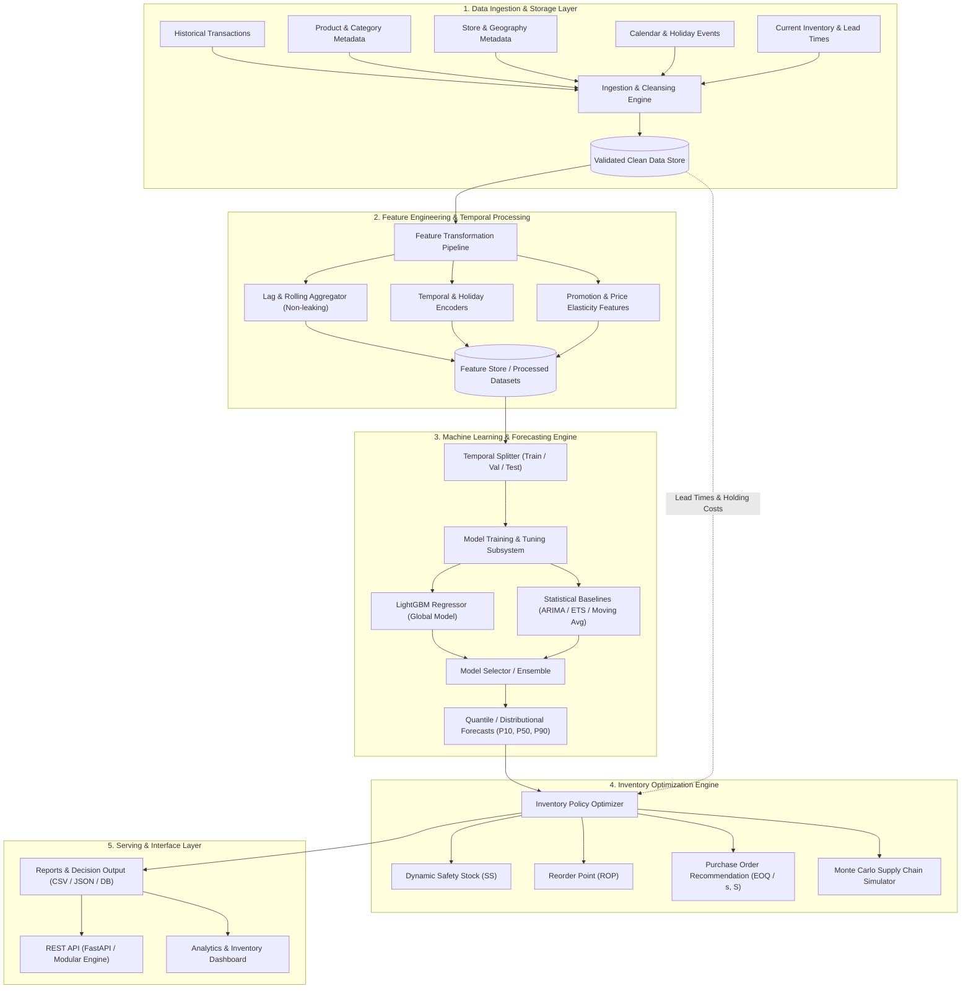

# 01 - System Architecture

## 1. System Overview

The **Retail Sales Forecasting & Inventory Optimization System** is an enterprise-grade predictive and prescriptive platform designed to solve two core supply chain challenges:
1. **Accurate Demand Forecasting**: Predict store-SKU level demand across multiple forecast horizons (e.g., 7-day, 14-day, 30-day) capturing seasonality, promotions, price elasticity, and stockout events.
2. **Optimal Inventory Policy Generation**: Translate probabilistic demand forecasts into cost-minimizing inventory actions, including dynamic Safety Stock (SS), Reorder Points (ROP), and Economic Order Quantities (EOQ) under service level constraints.

---

## 2. Architecture Diagram

---

## 3. Subsystem Architectural Details

### 3.1 Data Ingestion & Storage Layer
* **Responsibility**: Ingests heterogeneous data sources (transactions, metadata, inventory logs, supply lead times).
* **Guarantees**: Validates schema compliance, rejects anomalies, imputes missing dates (zero-sales imputation for active SKUs), and enforces referential integrity.
* **Storage Format**: Columnar formats (Parquet) partitioned by `store_id` or date for high-throughput reads.

### 3.2 Feature Engineering Layer
* **Responsibility**: Builds predictive signals strictly using historical timestamps prior to the prediction origin $T$.
* **Leakage Prevention**: All rolling windows, lags, and target-based encodings use shifting offsets (`shift(horizon)` or expanding past-only windows).
* **Feature Classes**:
  * Temporal / Calendar (Day of week, Month, Cyclical sin/cos encodings, Holiday flags).
  * Historical Demand (Lags: $t-7, t-14, t-28$; Rolling means/stds over 7, 14, 30, 60 days).
  * Product & Store Attributes (Category embeddings, Store type, Hierarchy groupings).
  * Dynamic Drivers (Price discount ratio, Promotional indicators).

### 3.3 Machine Learning & Forecasting Engine
* **Responsibility**: Generates point estimates and uncertainty bounds (e.g., P10, P50, P90).
* **Strategy**: Global tabular gradient-boosted trees (LightGBM/XGBoost) trained across all store-SKU series with categorical embeddings and hierarchical grouping, benchmarked against naive and classical time-series baselines.
* **Objective Functions**: Multi-objective evaluation including RMSE (mean expected demand) and Quantile Loss (Pinball Loss for asymmetrical over/under-prediction penalties).

### 3.4 Inventory Optimization Engine
* **Responsibility**: Translates probabilistic demand distributions into actionable supply chain triggers.
* **Core Logic**:
  * Calculates demand uncertainty over lead time ($\sigma_{L}$).
  * Computes safety stock using configured Service Level targets (Cycle Service Level $CSL \ge 95\%$).
  * Computes dynamic Reorder Point: $ROP = \mu_L + SS$.
  * Generates optimal order quantities considering batch constraints, holding costs, and order setup costs.

### 3.5 Serving & Presentation Layer
* **Responsibility**: Delivers forecast values, order recommendations, and validation metrics via structured APIs and reports.

