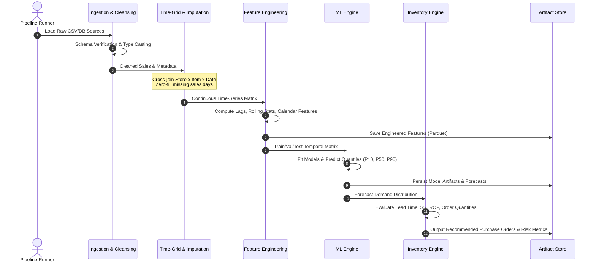

# 02 - Data Pipeline & Flow

## 1. End-to-End Data Lifecycle

The system transforms raw transactional records into actionable procurement recommendations via a sequential, staged pipeline. The pipeline enforces strict data contracts at each boundary.

---

## 2. Pipeline Stages in Detail

### Stage 1: Ingestion & Data Cleansing
1. **Source Ingestion**:
   * Reads raw sales transactions, item catalogs, store master data, calendar tables, and supplier inventory parameters.
2. **Data Cleansing**:
   * Identifies and filters negative transactions (e.g., returns or clerical corrections).
   * Validates date formats, removes duplicate records, and maps IDs to consistent categorical keys.
   * Enforces non-null constraints on primary keys: `(date, store_id, item_id)`.

### Stage 2: Temporal Grid Expansion & Eligibility-Aware Imputation
* **Domain Consideration**: In the **Corporación Favorita** dataset, observations are at the `(date, store_nbr, family)` grain. A missing row cannot naively be assumed to represent zero customer demand.
* **Resolution Policy**:
  * **Store Lifecycle Filtering**: Determine each store's true opening date via `transactions.csv` and do not generate dates prior to store inauguration.
  * **Assortment Active Window**: Restrict grid generation to `(store_nbr, family)` combinations that actively belong to that store format's product catalog.
  * **Store Operational Status**: Distinguish between store closures (e.g. Christmas, strikes, earthquake disruptions) and active trading days where zero sales occurred for an in-stock family.
  * **Controlled Imputation**: Only impute `0.0` sales for dates where the store was verified open and the product family was active in assortment.
  * Flag inactive periods (e.g., product discontinued or store closed).

### Stage 3: Feature Engineering Pipeline
* All features are derived strictly from information known at or before cutoff time $t$.
* **Lag Generation**:
  $$Lag_k(t) = y(t - k) \quad \text{for } k \in \{7, 14, 21, 28\}$$
* **Rolling Aggregations**:
  $$\text{RollingMean}_w(t) = \frac{1}{w} \sum_{i=1}^w y(t - \text{shift} - i)$$
  *(A mandatory shift equal to the forecast horizon prevents data leakage during multi-step forecasting).*
* **Calendar & Cyclical Signals**:
  * Day of week ($0 \dots 6$), Month ($1 \dots 12$), Day of month ($1 \dots 31$).
  * Sine/Cosine cyclical encodings: $\sin(2\pi \cdot \text{day} / 7)$, $\cos(2\pi \cdot \text{day} / 7)$, etc.
* **Categorical Encoding**:
  * Frequency encoding, category embeddings, or native LightGBM categorical handling.

### Stage 4: Temporal Splitting & Walk-Forward Cross-Validation
* Traditional random $k$-fold cross-validation is forbidden due to temporal leakage.
* **Validation Strategy**:
  * **Train Set**: Historical window $t_0 \dots t_k$.
  * **Validation Set**: Temporal window $t_{k+1} \dots t_{k+h}$ (where $h$ is forecast horizon).
  * **Test Set**: Most recent out-of-time evaluation block $t_{k+h+1} \dots t_{end}$.

### Stage 5: Inference & Inventory Translation
* The ML engine produces demand forecasts ($\hat{y}_{t+1 \dots t+h}$) along with error residuals ($\hat{\sigma}_\epsilon$).
* These predictions feed directly into the Inventory Engine to calculate replenishment parameters.

