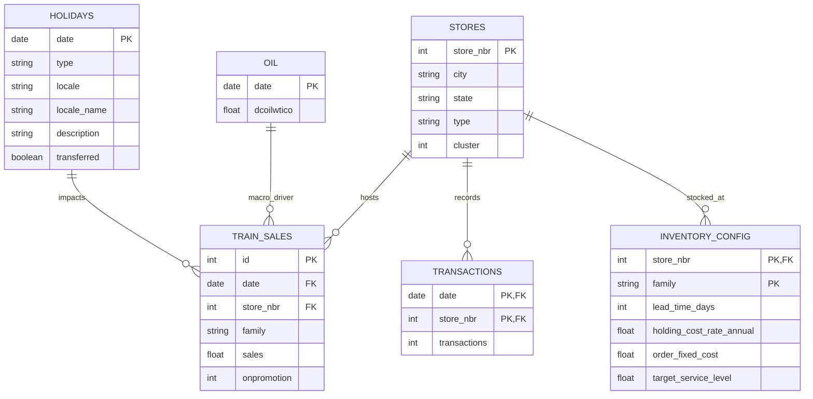

# 03 - Dataset Specifications: Corporación Favorita Store Sales

## 1. Primary Dataset Selection & Domain Context

The reference dataset for this project is **Corporación Favorita Store Sales** (Ecuador grocery retail). This dataset combines transactional daily sales across grocery retail stores with external economic drivers (oil prices), calendar events (local, regional, and national holidays), and store transaction volumes.

---

## 2. Entity-Relationship (ER) Diagram

---

## 3. Core Relational Schemas

### 3.1 `train.csv` (Daily Sales Demand)
* **Primary Key**: `id`
* **Grain**: `(date, store_nbr, family)`
* **Fields**:
  * `date` (`DATE`): Date of sales observation.
  * `store_nbr` (`INT`): Store identifier (1 to 54).
  * `family` (`VARCHAR`): Product family/category (e.g., `GROCERY I`, `BEVERAGES`, `CLEANING`, `PRODUCE`, `MEATS`). Note: This is an aggregated category, **not an individual SKU**.
  * `sales` (`FLOAT`): Total units/volume sold in that product family on that day.
  * `onpromotion` (`INT`): Count of unique items in that product family that were on active promotion on that date.

### 3.2 `stores.csv` (Store Metadata)
* `store_nbr` (`INT`): Store number.
* `city` (`VARCHAR`): Municipality (e.g., Quito, Guayaquil).
* `state` (`VARCHAR`): State / Province (e.g., Pichincha, Guayas).
* `type` (`VARCHAR`): Store format classification (A, B, C, D, E).
* `cluster` (`INT`): Grouping of similar stores based on historical behavior.

### 3.3 `transactions.csv` (Daily Foot-Traffic Activity)
* `date` (`DATE`), `store_nbr` (`INT`), `transactions` (`INT`): Total customer transactions at that store on that date. Critical for determining store operational open/close status.

### 3.4 `holidays_events.csv` (Calendar & Holiday Dynamics)
* `date` (`DATE`), `type` (`VARCHAR`), `locale` (`VARCHAR` - National, Regional, Local), `locale_name` (`VARCHAR`), `description` (`VARCHAR`), `transferred` (`BOOLEAN`).

### 3.5 `oil.csv` (Macroeconomic Factor)
* `date` (`DATE`), `dcoilwtico` (`FLOAT`): Daily crude oil price (WTI), heavily influencing Ecuador's national economy.

---

## 4. Critical Domain Policy: Why Missing Rows Cannot Automatically Be Imputed as Zero Demand

In grocery retail analytics, a naive Cartesian expansion `(Date × Store × Family)` with automatic zero-filling introduces severe distribution bias. In the Favorita environment, a missing row or unrecorded sales record stems from distinct structural causes:

1. **Store Operational Lifecycle (Openings & Closures)**:
   - Several stores in the dataset did not exist at the start date (2013-01-01) and opened years later (e.g., Store 52 opened in 2017).
   - Filling zero sales for Store 52 in 2013–2016 would erroneously train the model to predict zero demand on a non-existent store, corrupting model baselines and artificially driving down expected demand.
2. **Store Holiday & Maintenance Closures**:
   - Stores close on specific days (e.g., Christmas Day Dec 25). `transactions.csv` has no records on those days because transactions were 0 due to planned closure.
   - Closed-store demand is not consumer disinterest; treating it as an organic zero distorts seasonality and day-of-week demand multipliers.
3. **Assortment / Family Eligibility**:
   - Not every store format stocks every product family (e.g., small express stores do not carry hardware or automotive goods).
   - Forcing an ineligible family into a store's Cartesian grid with zero sales creates permanent phantom zero-demand series that distort inventory safety stock and variance formulas ($\sigma_D$).
4. **Exogenous Disruption (April 16, 2016 Ecuador Earthquake)**:
   - Stores in the coastal provinces (Manabí, Esmeraldas) experienced power loss, structural damage, and supply chain disruptions.
   - Sales irregularities during disaster response represent supply disruption and emergency relief flows, not regular steady-state consumer demand.
5. **Censored Demand (Stockout vs Zero Demand)**:
   - When an item family runs out of inventory on shelves, sales drop to 0 even if customer demand was positive. Without inventory availability tracking, zero sales reflects unfulfilled demand rather than true zero appetite.

### Evidence & Pre-Imputation Policy Requirements for Phase 3
Before any date imputation or time-grid expansion is executed:
* **Evidence 1 (Store Life Cycle)**: Determine `min(date)` where transactions first appear for each store. Only consider dates $\ge \text{store\_first\_active\_date}$.
* **Evidence 2 (Assortment Active Window)**: Identify whether `(store_nbr, family)` has ever exhibited positive sales in the relevant operating period. Filter out unstocked product families.
* **Evidence 3 (Store Open Indicator)**: Use `transactions.csv` to flag store operational days (`is_store_open = 1` if transactions $> 0$, else `is_store_open = 0`). Exclude closed store days from organic demand loss or model with explicit indicator flags.
