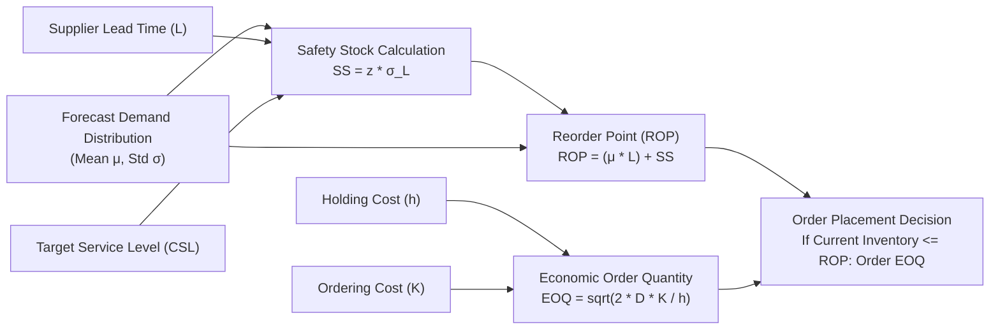

# 05 - Model Learning & Optimization

## 1. How the Machine Learning Model Learns

### 1.1 Supervised Tabular Time-Series Formulation
Forecasting is structured as a supervised regression task across panel data (multiple Store-SKU combinations over time).

For each store-item pair $(s, i)$ at time $t$, the feature vector $\mathbf{x}_{s, i, t}$ contains:
1. Past demand lags: $y_{s, i, t - k}$ for $k \ge H$ (where $H$ is the forecast horizon).
2. Rolling aggregate statistics: Mean, Standard Deviation over $[t-k-W, t-k]$.
3. Static metadata embeddings: Store format, region, SKU category, department.
4. Exogenous variables: Promotional status, discount percentage, holiday indicators.

The target is the future demand $y_{s, i, t + h}$ for horizon steps $h \in \{1 \dots H\}$.

---

### 1.2 Objective Functions & Loss Formulations

Standard MSE often underperforms on retail demand because retail sales are non-negative, discrete, skewed, and zero-inflated. The system leverages specialized objectives:

#### A. Tweedie Deviance Loss
For series with a mixture of exact zeros and continuous positive demand (compound Poisson-Gamma distribution):
$$\mathcal{L}_{\text{Tweedie}}(y, \hat{y}) = - \left( \frac{y \hat{y}^{1-p}}{1-p} - \frac{\hat{y}^{2-p}}{2-p} \right), \quad 1 < p < 2$$
* When $p \to 1$: Poisson distribution (count data).
* When $p \to 2$: Gamma distribution (continuous positive).
* In retail sales, $p \approx 1.5$ models positive mass at zero followed by continuous positive sales.

#### B. Quantile (Pinball) Loss for Probabilistic Bounds
To generate asymmetrical bounds for inventory risk (e.g. over-stocking vs under-stocking):
$$\mathcal{L}_\tau(y, \hat{y}_\tau) = \max \Big( \tau (y - \hat{y}_\tau), (\tau - 1)(y - \hat{y}_\tau) \Big)$$
* For $\tau = 0.5$: Computes the Median forecast (P50), robust against outliers.
* For $\tau = 0.9$: Computes the 90th percentile (P90), used for high-service-level safety stock.
* For $\tau = 0.1$: Computes the conservative lower bound (P10).

---

### 1.3 Tree Learning Mechanics (LightGBM)
* **Histogram-based Split Finding**: Groups continuous feature values into discrete bins, accelerating training on multi-million row datasets.
* **Leaf-wise (Best-First) Tree Growth**: Expands leaves that yield maximum loss reduction, capturing complex non-linear promotional interactions.
* **Categorical Feature Binning**: Native handling of store and product IDs without memory-intensive one-hot encoding explosions.

---

## 2. Inventory Optimization Mathematics

The inventory engine connects demand prediction distributions to cost-optimal operational policies.

### 2.1 Dynamic Safety Stock ($SS$)
Safety stock buffers against demand fluctuations and lead-time delays:
$$SS = z \cdot \sigma_L$$
Where:
* $z$: Inverse standard normal CDF $\Phi^{-1}(CSL)$ for target Cycle Service Level (e.g., $z = 1.645$ for 95% CSL, $z = 2.054$ for 98% CSL).
* $\sigma_L$: Standard deviation of demand over lead time $L$.

When both daily demand variance ($\sigma_D^2$) and lead-time variance ($\sigma_{LT}^2$) exist:
$$\sigma_L = \sqrt{\bar{L} \cdot \sigma_D^2 + \bar{D}^2 \cdot \sigma_{LT}^2}$$

### 2.2 Reorder Point ($ROP$)
The inventory level that triggers a replenishment order:
$$ROP = (\bar{D} \cdot \bar{L}) + SS$$
Where:
* $\bar{D} \cdot \bar{L}$: Expected cumulative demand during the lead-time window.

### 2.3 Economic Order Quantity ($EOQ$)
Balances fixed order placement cost ($K$) against annual holding cost per unit ($h$):
$$EOQ = \sqrt{\frac{2 \cdot D_{\text{annual}} \cdot K}{h}}$$

### 2.4 Replenishment Decision Rule ($(s, S)$ or $(s, Q)$)
At any evaluation step $t$:
* **Inventory Position**:
  $$\text{IP}_t = \text{Stock On Hand} + \text{Stock On Order} - \text{Backorders}$$
* **Order Trigger**:
  $$\text{Order Quantity } Q_t = 
  \begin{cases} 
  \max(EOQ, \, S - \text{IP}_t) & \text{if } \text{IP}_t \le ROP \\ 
  0 & \text{otherwise} 
  \end{cases}$$

